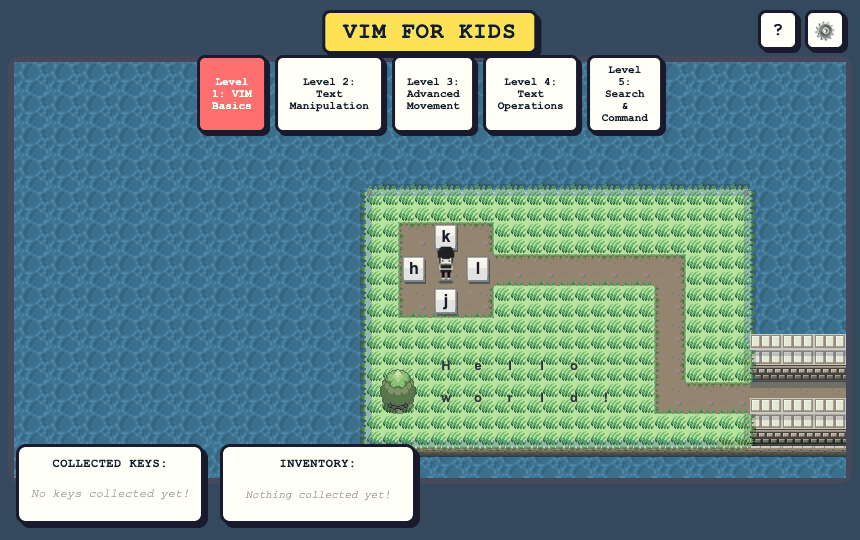
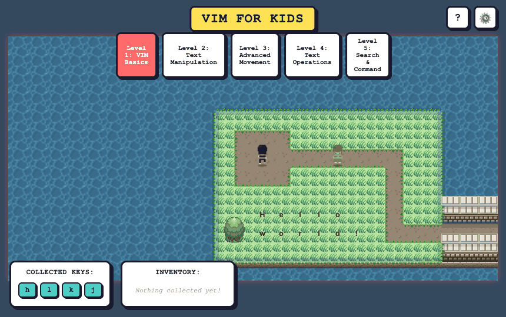
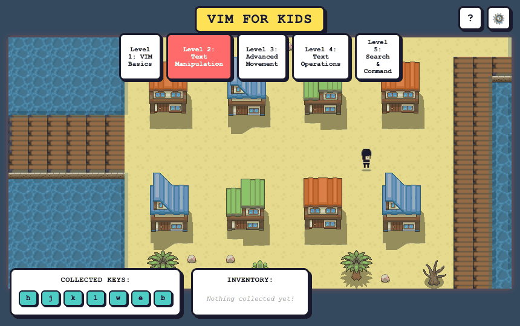

# VIM for Kids

A browser game that teaches children VIM's movement commands — `h`, `j`, `k`,
`l` — through play.

Players guide a cursor around a colorful grid world, collecting the four movement
keys while picking up the navigation habits that underpin VIM proficiency. Both
the VIM keys and the arrow keys work, so beginners can start with whichever feels
natural.



Walk onto each letter to unlock it and see what it does.



Bump into a character to hear what it has to say.



`w` only works on text — on the word bridges it hops from word to word.

## Play

Open `index.html` in any modern browser to play immediately, or run it locally:

```sh
git clone https://github.com/helmedeiros/VIM-for-kids.git
cd VIM-for-kids
npm install
npm run dev        # http://localhost:3000
```

## How to play

Collect all four movement keys scattered across the map, staying on walkable
paths and avoiding water tiles.

| Key       | Move  |
| --------- | ----- |
| `h` / `←` | Left  |
| `j` / `↓` | Down  |
| `k` / `↑` | Up    |
| `l` / `→` | Right |

Each key collected shows its VIM command and a short description.

## Characters

- **Cursor** — the blinking protagonist you control, curious and eager to explore.
- **Caret Spirits** — guardians scattered across the land who share VIM knowledge
  when discovered.
- **The Bug King** — the final enemy who corrupts logic and overwrites order.
- **Syntax Wisps** — optional lore spirits that explain more advanced concepts.

## Technology

- Pure JavaScript (ES6+), HTML5 and CSS3.
- Hexagonal (ports and adapters) architecture.
- Vite for development and builds; Jest for tests (92%+ coverage); ESLint and
  Prettier for code quality.

## Documentation

Deeper guides live under `doc/`:

| Document                                   | Purpose                              |
| ------------------------------------------ | ------------------------------------ |
| `doc/README.md`                            | Documentation index.                 |
| `doc/DEVELOPMENT.md`                       | Setup, workflow and best practices.  |
| `doc/ARCHITECTURE.md`                      | The hexagonal architecture.          |
| `doc/TRUNK_BASED_DEVELOPMENT.md`           | Branching and release workflow.      |
| `doc/CONVENTIONAL_COMMITS.md`              | Commit message standards.            |

## Contributing

Start from `doc/DEVELOPMENT.md`, review `doc/ARCHITECTURE.md` to understand the
structure, add tests for your change, and make sure `npm test` and `npm run lint`
pass before opening a pull request.

## License

This project is licensed under the [MIT](LICENSE) License.
